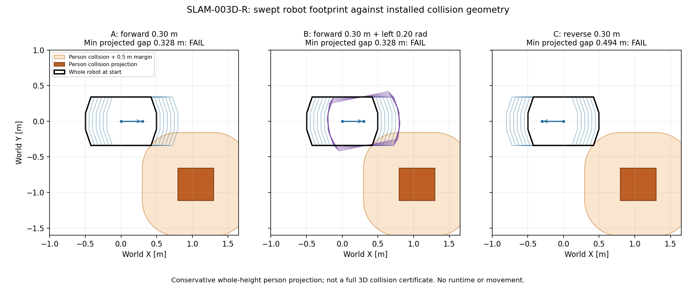

# SLAM-003D-R — Static route review

2026-11-17. **Decision: no route verified; no new experiment reservation.** The 0.5 m requirement is retained. No runtime process or movement command was launched. Existing `slam003d_001`, configurations, checkpoints and uncommitted work are preserved.

The earlier [SLAM-003D-B attempt](../../evidence/command_outputs/2026-11-17-slam-003d-b-preflight-abort.txt) stopped before GLIM/movement on a chassis-only, height-filtered LiDAR turn-clearance estimate of 0.486875 m. This review broadens the inspection to the full robot and installed world collision geometry. The new results use a different, more conservative geometry model; they do not overwrite or retroactively replace the earlier measurement.

## Evidence and free-space reconstruction

- Original stationary bag: `/home/feras/glim_ws/runs/mode_a_mapping/slam003d_001/bag/`. All 957 adapted clouds were inspected with the installed native rosbag2 reader. They span header stamps 171.702–267.501 s and have identical XYZ geometry: 5,620 finite unique returns. Repeated stationary scans do not reveal occluded surfaces or new viewpoints. The saved reference confirms no motion and identity model/base transform.
- Robot description: inspected the existing combined xacro in memory only, with installed native xacro expansion. No Clearpath generator or robot/configuration file write. Resolved **16 collision parts**, including chassis, suspension, motors, four wheels, both bumpers and top plate. The whole-robot convex footprint includes those parts; the chassis mesh alone is also retained for comparison.
- Body-frame bounds of collision geometry: X `[-0.497704,0.497704]`, Y `[-0.340050,0.340050]`, Z `[-0.135970,0.242259]` m. Whole footprint is about 0.9954×0.6801 m. Sensor link heights are checked against the existing description; the synthetic LiDAR link has no physical collision body, so no hardware-clearance claim is made.
- Installed warehouse world and local cached assets: **25 included models / 49 collision geometries**, plus ground support. All relevant include/link/collision transforms and mesh scales are applied. Floor contact is intended, so the ground plane and 188 sub-floor/support triangles are excluded. High roof surfaces outside body height plus margin are irrelevant to this projected check. These are explicit modeling exclusions, not a full 3D/terrain certificate.
- The limiting obstacle is the static `Person 1 - Standing` / `MaleVisitorOnPhone` at world `(1,-1,0)`, yaw 1.57 rad. Its collision OBJ differs from visible body surfaces. Full-height collision projection bounds are approximately X `[0.797694,1.299276]`, Y `[-1.113820,-0.658856]` m; the upper body contributes to that projection. The nearby shelf at `(0.4,-2)` and warehouse/other geometry were included; the person remains limiting.
- `chair_0` and `chair_1` omit the SDF `static` property, so their nominal scene poses are not treated as verified current dynamic poses. They are distant and do not determine these failed margins. A future positive certificate would still need current-scene verification.

The collision model makes clear why cloud-only free space is insufficient: finite returns represent visible surfaces, while the simulated collision envelope may extend closer. Empty or occluded LiDAR regions are **unverified**, not certified free space.

## Candidate command sequences and complete sweeps

All candidates retain a minimum 10 s stationary initialization period and an 8 s final zero-command period. Durations below are nominal simulation seconds before discovery/authorization gaps. Proposed commands are stamped at 20 Hz on the existing mux input `/a300_00000/cmd_vel`; they are analysis specifications, **not approved commands to execute**. Linear/angular speeds stay below the existing maxima 0.15 m/s and 0.20 rad/s.

| Candidate | Proposed motion between stationary periods | Total nominal duration | Translation / rotation |
|---|---|---:|---|
| A | Forward 0.10 m/s for 3 s, then zero | 21 s | +0.30 m / 0 rad |
| B | Forward 0.10 m/s for 3 s; zero 2 s; left yaw 0.10 rad/s for 2 s; zero | 25 s | +0.30 m / +0.20 rad |
| C | Reverse 0.10 m/s for 3 s, then zero | 21 s | −0.30 m / 0 rad |

The 3 s straight stages correspond to 61 messages at 20 Hz, the 2 s stages to 41, and the final 8 s stop to 161. Other twist components remain zero. No such messages were published.

Each path includes its **initial pose**, complete translation, any rotation and final hold. Translation samples are at 5 mm spacing; B additionally samples its full 0–0.20 rad turn at 0.002 rad spacing. The exact convex translation sweep independently reproduces the straight-stage minima, rather than checking only endpoints. A conservative 3.041 mm sampling allowance bounds possible between-sample displacement. The whole-robot footprint radius is about 0.5413 m.

| Candidate | World collision projected minimum | LiDAR-return-only minimum | Limiting pose | Clearance result |
|---|---:|---:|---|---|
| A | **0.327963 m** | 0.617960 m | End of forward translation, X=0.30 m | FAIL to establish 0.5 m |
| B | **0.327963 m** | 0.617960 m | End of forward translation, before turn | FAIL to establish 0.5 m |
| C | **0.493693 m** | 0.762807 m | Initial pose; reversing improves separation | FAIL to establish 0.5 m |

All are limited by the standing-person collision projection. In particular, a shorter or reverse route does not remove the initial-pose constraint of the retained conservative projected-footprint check. The original long turn and second forward movement are not proposed again.

## Uncertainty and 3D interpretation

The illustration and projected minima are conservative bounds. The full robot convex hull fills gaps, wheel cylinders use circumscribed 64-sided solids (less than 0.2 mm radial excess), and full-height obstacle projection includes upper-body overhang. A failed projected bound does **not** prove an actual collision or a physical 3D distance below 0.5 m. Conversely, passing a cloud-only planar check cannot certify 3D collision freedom.

An independent convex support-plane diagnostic uses the full 3D robot envelope and the installed standing-person collision vertices at the recorded world/base height. Sampled person-only separation lower bounds are approximately **0.449747 m for A/B** and **0.583320 m for C**. The larger C value explains why projecting upper-body overhang can be more restrictive than 3D separation. These are person-only diagnostics, not a full-world continuous-motion certificate, and are not used to override the failed projected check.

An illustrative planning budget adds 50 mm translation error, 0.02 rad yaw error converted using the full footprint radius, 10 mm geometry allowance and 10 mm tilt/vertical-projection allowance: **80.825 mm**, plus the 3.041 mm sampling bound. These are explicit assumptions, not measured controller guarantees. Conservative planar lower bounds become **0.244096 / 0.244096 / 0.409827 m**. No result hinges on lowering a margin or tuning that budget to obtain a pass. Sensor blind zones, dynamic scene poses, ground/part articulation and runtime tracking remain limitations.

**Selected route: none.** No candidate meets the retained conservative clearance evidence requirement. Complete 3D continuous swept-volume validation, together with a justified tracking/error envelope and current-scene evidence, would be needed to determine whether the reverse alternative can be certified under the same 0.5 m physical clearance requirement. This review does not authorize a changed metric, a reduced margin, moving the person, a new spawn or any runtime test.

## Reservation, commands and recording quality

Because no route passes, **`slam003d_002` was not created**, no new operational GLIM configuration was made and no replacement runtime launch/velocity command sequence is issued. The existing [SLAM-003D-B procedure](slam003d_b_procedure.md) remains unchanged as the historical reviewed procedure; it is not authorization to execute its blocked route. `slam003d_001` remains consumed and must not be reused.

The independent reference bridge and explicit 11-topic recorder approach remain the reference design. SLAM-003D-B reported **three transport-layer losses without per-topic attribution**; the bag is not claimed lossless. For any later approved experiment, require a fresh run and report:

1. Recorder transport-loss totals and any available per-topic event counters, preserving explicit `unknown` when attribution is absent.
2. Native bag readability, metadata-versus-read message counts, per-topic header coverage/rates, stamp gaps, duplicates and decreases, and original/adapted header-pair coverage restricted to their shared recording interval.
3. Differences between discovery/start/stop boundaries and proven transport drops; do not label every missing sequence interval a transport loss or infer losslessness from counts alone.
4. Gaps/loss bursts during motion as abort/data-quality conditions under the existing supervised procedure. Preserve all raw logs privately; change recording settings only after separate review, rather than silently tuning QoS or replacing the architecture.

Three separate user authorizations would still be required for simulator/inputs/recording, GLIM and motion if a later route is certified. None is requested or exercised here.

## Reproduction and preserved state

[Offline utility and exact invocation](../../tools/slam_route_clearance/README.md). Detailed analysis, source hashes, geometry arrays, preservation snapshots and preliminary static-analysis diagnostics are private under `/home/feras/glim_ws/planning/slam003d_r_001/`; no runtime output lives there. Six analytic geometry checks passed, including intersecting segments, separated/overlapping polygons and 3D box separation; exact continuous translation checks match the route results. This validates the computations used, not the unverified safety of a moving robot.

Branch remains `codex-work`; checkpoint `60c39e30bf50b72b62d2e9c51988482790685c3f` and protected `main` are unchanged. Old datasets/configurations/evidence and prior uncommitted content are preserved. No commit, push, stash, reset, clean, generator, package change, simulation, GLIM, recorder, GUI or publisher was run. [Sanitized evidence](../../evidence/command_outputs/2026-11-17-slam-003d-r-static-route-review.txt).
