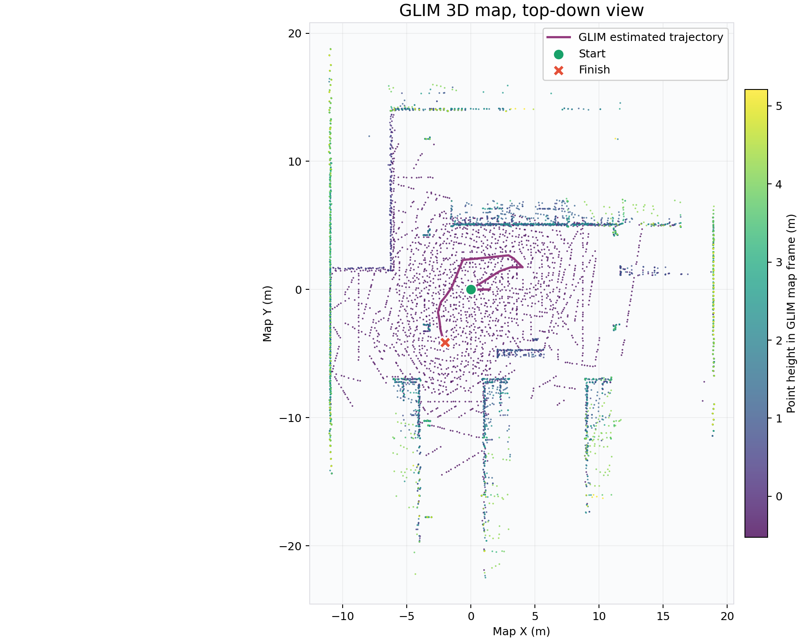
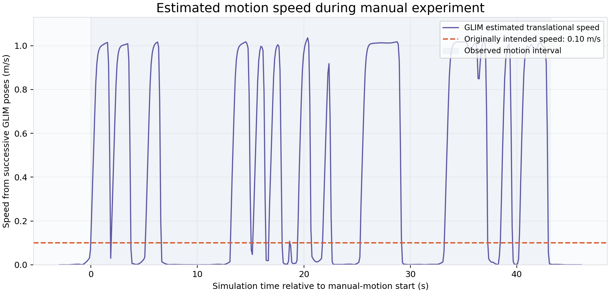

# SLAM-003E — Manual GLIM mapping figures

**Imported:** 2026-11-21. **Source run:** `slam003e_manual_001`. These are the user's downloaded ChatGPT analysis exports associated with `glim_manual_mapping.tar.gz`. The original Downloads files remain unchanged; copied-file sizes and SHA256 values are recorded in [assets.json](assets.json).

## Top-down map and trajectory

**Caption:** Top-down projection of the reconstructed GLIM point cloud with estimated trajectory and start/finish markers. Points are colored by height in the GLIM map frame; map axes and height are in metres. This is a reconstruction/trajectory illustration, not an independently aligned ground-truth map.

[Open PNG](2026-11-21_SLAM-003E_map-eagle-view_v01.png). Original export: `glim_3d constracted map_eagleview.png`.

## Estimated motion speed

**Caption:** The exported plot labels translational speed estimated from successive GLIM poses during the manual motion interval, with time relative to motion start. The dashed 0.10 m/s intended-speed reference contrasts with the roughly 1 m/s observed motion. It is an estimated pose-derived speed plot, not a controller-command trace or proof of speed-limit enforcement.

[Open PNG](2026-11-21_SLAM-003E_motion-speed_v01.png). Original export: `glim_motion_speed.png`.

## Interactive map

[Open/download interactive HTML map](2026-11-21_SLAM-003E_map-interactive_v01.html).

This export contains an interactive GLIM map and estimated trajectory with GLIM-frame X/Y/Z axes in metres. Plotly is embedded and no external script-source tags were found. JavaScript was not executed during archival; browser behavior and rendering calculations were not independently reproduced. Open the local HTML in a browser to interact with it. Original export: `glim_map_interactive.html`.

## Documentation context

- [SLAM-003E experiment record](../../../docs/08_slam_integration.md#21-slam-003e--user-driven-husky-mapping-native-save-and-upload-package).
- [Sanitized runtime evidence](../../command_outputs/2026-11-21-slam-003e-manual-mapping.txt).
- Native source: 9,579 frames, one submap, 7,203 finite points; four valid trajectories and successful native reload. The raw dump and upload archive remain outside Git.
- Relevant limitations: actual command maxima exceeded the intended 0.10 limits; three IMU-prediction warning blocks; long stationary prefix; Mode A zero point times/global-shutter approximation; sensor-frame trajectories are not automatically base-link or Gazebo-world trajectories. No accuracy/loop-closure claim.
- Both PNGs were visually inspected; the rendering method, exact trajectory selection and alignment from the external ChatGPT analysis have not been independently reproduced. Plotting/editable source was not supplied. Importing these files does not upgrade their experimental validation status.
